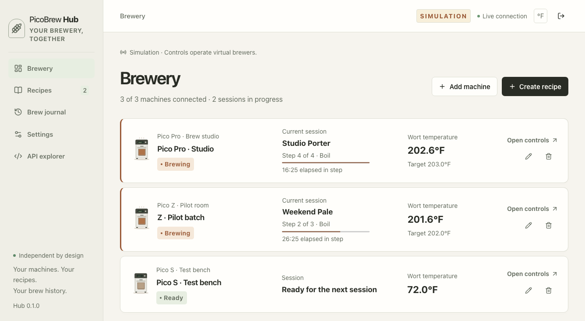

# PicoBrew

Brew with your own recipes and keep your brew history on your own network. This project provides **standalone firmware** for PicoBrew appliances and an optional **PicoBrew Hub** that runs on a Mac, Windows PC, Linux computer, or Raspberry Pi.

The firmware keeps the brewer's heating, pumping, and timing on the machine. On supported models it adds a local website, an authenticated API, and saved programs you can brew without PicoBrew's online service. The Hub brings your machines, recipes, and brew journal into one browser.



*The Hub simulator uses virtual machines and example readings. You can try it before connecting a brewer.*

## What you can do

| Feature | How it works |
| --- | --- |
| **Build a recipe** | Start from the offline catalog, import BeerXML, or use the wizard. Assign hops to timed additions, then preview the grain bill, hop-slot loads, estimated yield, and steps for your brewer. The Hub keeps ingredient proportions when scaling and explains what prevents a transfer. |
| **Brew from your browser** | Send a program to an idle, compatible brewer, review it, and start it as a separate action. Follow multiple brews on the Brewery page. Open a machine to read its screen, answer prompts using the virtual dial, and use the controls its firmware reports. |
| **Keep a brew journal** | Inspect temperature and machine state together, pin a note to a sample, rate the result, and export CSV or JSON. Record fermentation stages and carbonation as part of the brew. |
| **Look after your machine** | Read the model's cleaning guidance, back up supported stock firmware over USB, and manage compatible firmware versions. A provisioned Pico S or Pro can install an update from the Hub over Wi-Fi. |
| **Connect other tools** | Explore the Hub and device APIs. Optionally connect a brew assistant to draft a recipe or discuss a brew's recorded measurements. |

[See the feature tour and screenshots](docs/hub-tour.md) · [Compare firmware features by machine](docs/firmware-parity.md)

## Set up the Hub

### 1. Download the Hub for your computer

Choose your file below. Put it in a permanent folder called `PicoBrew`. The executable includes the website, recipe catalog, and USB programmer. Use the computer that will stay on your brewery network.

| Computer | Download |
| --- | --- |
| Mac | [Apple silicon](https://github.com/jeffreydwalter/picobrew/releases/download/usb-tools-v1.0.1/picobrew-hub-darwin-arm64) · [Intel](https://github.com/jeffreydwalter/picobrew/releases/download/usb-tools-v1.0.1/picobrew-hub-darwin-amd64) |
| Windows | [64-bit Intel or AMD](https://github.com/jeffreydwalter/picobrew/releases/download/usb-tools-v1.0.1/picobrew-hub-windows-amd64.exe) |
| Linux with glibc | [64-bit Intel or AMD](https://github.com/jeffreydwalter/picobrew/releases/download/usb-tools-v1.0.1/picobrew-hub-linux-amd64) · [64-bit ARM](https://github.com/jeffreydwalter/picobrew/releases/download/usb-tools-v1.0.1/picobrew-hub-linux-arm64) |
| Raspberry Pi | [64-bit Raspberry Pi OS](https://github.com/jeffreydwalter/picobrew/releases/download/usb-tools-v1.0.1/picobrew-hub-linux-arm64) · [32-bit Raspberry Pi OS on ARMv7 or newer](https://github.com/jeffreydwalter/picobrew/releases/download/usb-tools-v1.0.1/picobrew-hub-linux-arm) |

These are the **USB tools 1.0.1** release builds. Newer Hub features pictured here are on `master`. For that version, follow the [source build instructions](server/README.md#run-locally-on-windows-macos-or-linux). The published checksums and included firmware versions are in the [release notes](https://github.com/jeffreydwalter/picobrew/releases/tag/usb-tools-v1.0.1).

### 2. Start the Hub

**Mac, Linux, or Raspberry Pi.** Rename the downloaded executable to `picobrew-hub`. Open a terminal in your `PicoBrew` folder and run these commands.

```sh
chmod +x ./picobrew-hub
./picobrew-hub --data ./data
```

**Windows.** Open the `PicoBrew` folder in File Explorer, type `powershell` in the address bar, and press Enter. Run this command.

```powershell
.\picobrew-hub-windows-amd64.exe --data .\data
```

Open **[http://127.0.0.1:8080](http://127.0.0.1:8080)** on that computer. For a headless Pi, open `http://<Pi's LAN IP>:8080` on another computer on the same network. Enter the setup token printed in the terminal and choose an owner password. Leave the Hub running while you use it.

To try a virtual brewery first, add `--demo` and use `--data ./demo-data` in place of `--data ./data`. Open the browser on the Hub computer for this loopback-only mode. Press **Ctrl+C** to stop the Hub before switching modes. To keep your real brewery, restart from the same folder and back up the entire `data` directory, including its encryption key, while the Hub is stopped. [Backup and operations](server/docs/operations.md)

### 3. Connect your machine

- **Already running standalone firmware?** Open **Brewery → Add machine**, enter the brewer's network address, and follow the pairing prompt. On firmware with dial pairing, confirm the displayed code under **About → Pair with Hub**. The Hub saves the key. Older firmware can use the key file from USB setup. [Connection and pairing guide](server/docs/device-connections.md)
- **Still running the original firmware?** Check your model below. For a supported conversion, connect the idle machine or its service adapter by USB to the **computer running the Hub**. Open **Brewery → Add machine → USB setup and recovery**, select the physical model and port, and follow the backup, power, and verification prompts. Keep the original backup. After setup, join the network and finish adding the machine. [USB setup, requirements, and stock restoration](server/docs/firmware-packages.md#usb-setup-backup-and-stock-restoration)
- **Keeping a stock Zymatic?** The Hub can publish recipes to the original 1.1.14 brewer menu through its LAN protocol. This requires configuring the brewer's DNS and HTTP route. Select the recipe and start it at the machine. [Stock Zymatic setup](server/docs/stock-zymatic.md)

**Using a release binary for firmware updates?** In **Settings → Firmware**, set the GitHub repository to `jeffreydwalter/picobrew` and leave the branch blank to use the default. Earlier Hub builds store the project's former name.

### 4. Send your first recipe

Open **Recipes → Browse all**, choose a recipe, and copy it to your library. Open the saved recipe, choose **Send**, select your brewer, and review the scaled quantities and schedule. After transfer, use the receipt to open the machine. Check the physical load and preparation prompts before choosing **Start recipe** on a compatible machine. [Recipe transfers](server/docs/recipe-transfers.md)

## Which machines work?

| Machine | What to expect |
| --- | --- |
| **Pico S and Pico Pro** | Model-specific standalone firmware, local website, mirrored OLED and dial, saved recipes, history, and Hub control. An idle brewer with compatible recovery supports wireless updates. Wireless return to stock has narrower hardware requirements. |
| **Pico C** | Standalone brewing and Hub integration for the SSD1325 and SSD1309 display variants. USB setup checks the display variant. Physical installation and brewing qualification remain pending. |
| **Z-series** | A generic Z module build provides programs, display, history, and Hub controls. USB setup requires a qualifying individual module. A Z1 or Z2 label alone does not establish compatibility. |
| **Zymatic** | Stock 1.1.14 can fetch Hub recipes. Custom 1.2.0 adds an offline recipe and wired monitoring. On a verified boot layout, 1.3.x also adds paired dial control and retained history. Updates use USB. Physical qualification remains pending. |
| **PicoFerm and PicoStill** | Accessory-specific builds expose fermentation recording and sensors on PicoFerm, and still modes, pump, fans, and sensors on PicoStill. These are software-tested reference builds awaiting hardware qualification. |

## Project guides

- [Hub guide](server/README.md) · [Docker setup](server/README.md#run-with-docker) · [Hardware and feature coverage](server/docs/coverage.md)
- [Firmware by machine](firmware/README.md) · [Build and verify firmware](docs/platforms.md) · [Firmware updates and recovery](server/docs/firmware-packages.md)
- [Recipe catalog and original records](server/docs/community-catalog.md) · [Brewer capacities and scaling](server/docs/equipment-profiles.md)
- [Source provenance](docs/consolidation.md) · [Licenses and third-party notices](LICENSES.md)
