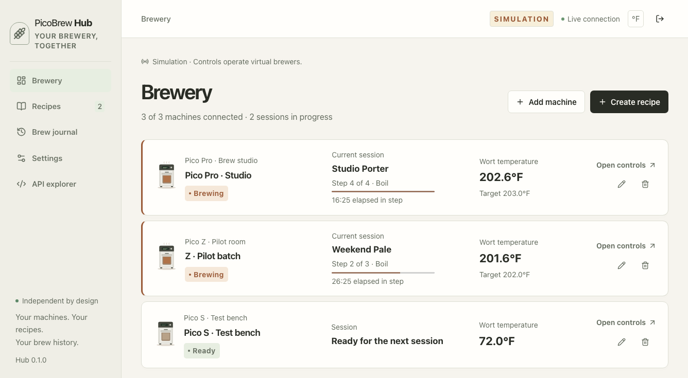
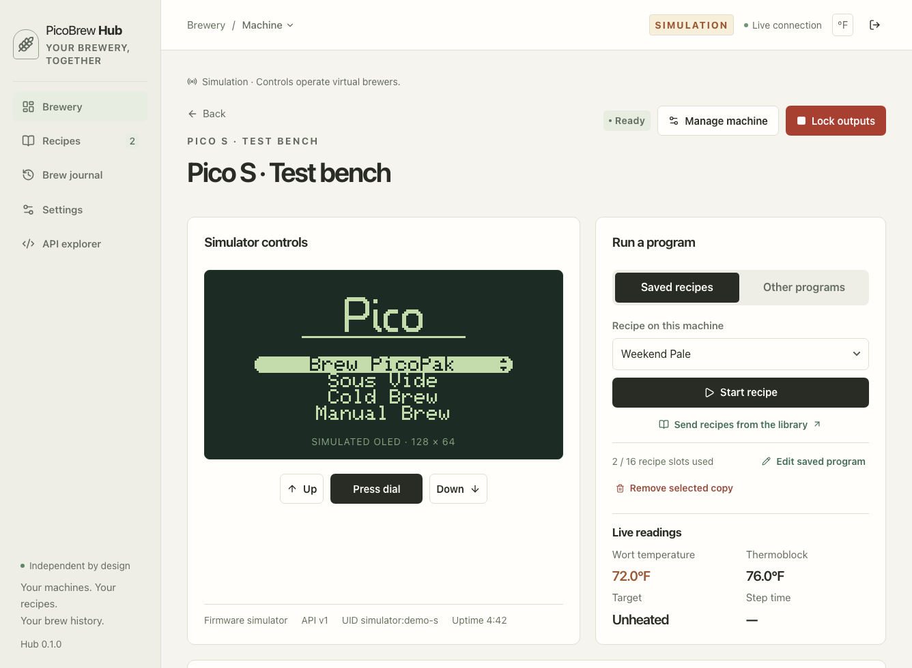
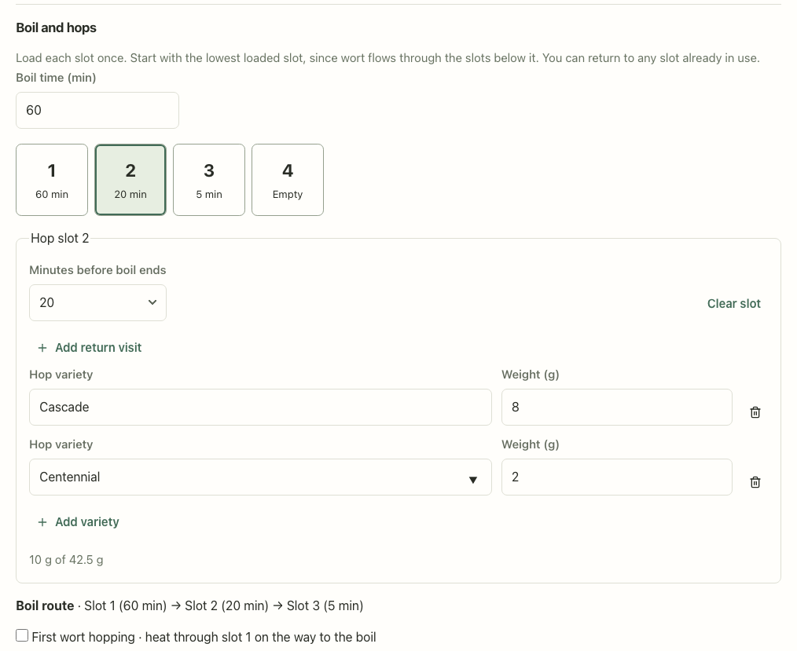
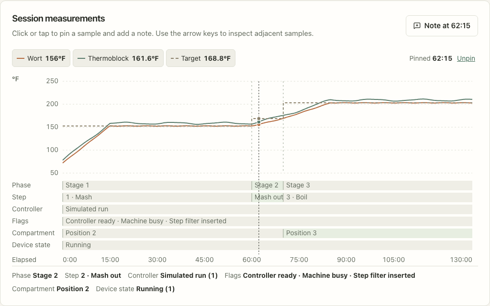

# A brew day with PicoBrew Hub

The screenshots show the current Hub running in simulation. The brewers, recipes in progress, and sensor readings in these examples are virtual.

## See what’s brewing

Open **Brewery** to see all your machines together. Each brewer has its own row, so you can follow two brews at once. During a session, look for the current step, wort temperature and target. If a brewer needs attention, open its row to see the prompt. An offline machine stays in the list.

## Use the front panel

Choose **Open controls** on a brewer that supports remote control. **Front panel** mirrors its display. Use **Up**, **Down** and **Press dial** to navigate the menu and respond to prompts. The readings beside the screen come from that machine. A monitoring-only connection offers **View machine**.

Under **Saved recipes**, select an installed recipe and choose **Start recipe** when the brewer is loaded and ready. **Stop and lock outputs** stops heating and pumping on a supported brewer and keeps them off until you unlock them. When the brewer is already idle, the button reads **Lock outputs**. To open the brewer’s own site on a paired machine that supports it, choose **Manage machine → Open machine website**. For cleanup after a session, **Cleaning and maintenance** links to the manufacturer’s instructions for that model.

## Build a recipe and load the brewer

In **Recipes**, open **Browse all** to find a starting recipe. To start from scratch, choose **Add recipe → Create for a brewer**. That same menu offers **Import recipe** for an existing file and **Ask the brew assistant** when you want help drafting a recipe. The wizard takes you through **Brewer**, **Ingredients**, **Mash** and **Review**. Assign each hop variety to its physical slot. Varieties sharing a slot share an addition time, and their combined weight counts toward its capacity. The **Advanced editor** gives you individual mash rests and other recipe settings.

When you choose **Send**, select the destination and open **Preview recipe**. Check the estimated yield, grain weight and each hop load before filling the step filter. The Hub scales ingredients together to fit the brewer. If the source leaves an essential quantity or operation unresolved, the preview explains what prevents transfer. **Send to machine** saves the program. Starting it is a separate action. Stock Zymatic owners can retrieve a queued recipe through the machine’s sync menu. [Recipe transfers](../server/docs/recipe-transfers.md) · [Stock Zymatic](../server/docs/stock-zymatic.md)

## Review the brew and follow fermentation

Open **Brew journal** and select a session. On **Session measurements**, click or tap a reading to pin it. The chart aligns temperatures with machine state so you can see what changed at that moment. Add a timestamped note or use the arrow keys to inspect adjacent samples. **Session timeline** records reported transitions, and **CSV** and **JSON** export the session for comparison.

Use **Fermentation and carbonation** to track the stages of a planned brew after it leaves the brewer. Record when you start and finish each stage, then keep tasting notes and a rating with the session.

## Firmware, device website, and integrations

Open **Firmware** on a machine to see its installed version and check for updates. An eligible Pico S or Pro offers compatible wireless upgrades and downgrades. For first-time conversion, use **Add machine → USB setup and recovery** on the computer connected to the appliance. The Hub saves the original for that machine. [Firmware installation and recovery](../server/docs/firmware-packages.md)

A brewer running standalone firmware can also serve its own website. Use the machine's management dialog to open it with the saved pairing credential where supported. The local site shows that appliance's controls and history. **API explorer** in the Hub documents the endpoints for managing multiple machines and the shared recipe library. [Pairing and the brewer website](../server/docs/device-connections.md)

**Settings** includes appearance, equipment preferences, data export, and the optional brew assistant. Once a provider is connected, the assistant can draft a recipe, discuss a live brew you opt into monitoring, or review a finished session. You review the draft and operate the brewer yourself. [Brew assistant setup](../server/README.md#connect-the-brew-assistant)
